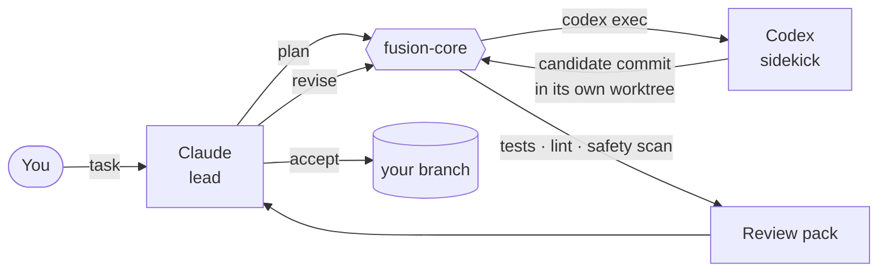

<p align="center">
  <picture>
    <source media="(prefers-color-scheme: dark)" srcset="assets/logo-dark.svg">
    
  </picture>
</p>

<p align="center">
  <strong>One lead. One sidekick. One reviewed result.</strong><br>
  A Claude Code plugin that lets Claude plan and review while Codex writes the code,<br>
  so your frontier-model budget goes to judgment, not typing.
</p>

<p align="center">
  <a href="https://github.com/MuraBot/lyfusion/tree/v5.0.0"></a>
  <a href="LICENSE"></a>
  
  
</p>

<p align="center">
  English · <a href="README.zh-CN.md">简体中文</a>
</p>

---

## Why lyfusion

Frontier models are excellent at deciding *what* to build and at catching what is wrong. They are expensive to spend on writing every line. lyfusion splits the work:

- **Claude is the lead.** It reads the code, writes the plan, reviews the result against your whole request, and decides when it is done.
- **Codex is the sidekick.** It implements the plan, writes the tests, and fixes lint, inside an isolated git worktree.
- **A local engine keeps them honest.** `fusion-core` runs your test and lint commands on every candidate, scans for unsafe changes, and hands the lead a compact review pack. Nothing reaches your branch until the lead accepts it.

In our benchmarks the lead used about **30–40% less Claude budget** than Claude working alone, with the same quality ([details](#benchmarks)).

## Features

- **Four blocking commands.** The lead works through `explore`, `delegate`, `revise` and `accept`. Each call waits for the sidekick and returns a result, so the lead spends one request per exchange instead of polling.
- **Plan tiers.** The lead does small changes itself, delegates when it knows where the change goes, and asks the sidekick to explore first when it does not.
- **Review packs.** Brief differences, check results, safety findings, the sidekick's questions and choices, changed test expectations, and the most important diffs first, all within a fixed budget.
- **Checks you define.** Your test and lint commands run on every candidate. Plans can add their own checks, such as a script that proves the result.
- **Safe integration.** Accepted work is re-checked, squashed into one commit and fast-forwarded onto your base branch. `--minor-fix` lets the sidekick make a last small fix under strict limits.
- **Recovery built in.** Stalled runs are flagged after 10 quiet minutes. `takeover` moves the sidekick's latest candidate, or its unfinished changes, into your working tree. `cancel` keeps a diff as evidence.
- **A ledger.** Per-task lead calls, Claude usage, sidekick tokens, run times and revision rounds.
- **Fusion card.** In the Claude desktop app, a button beside the model picker opens a small card for the on/off switch, sidekick model, reasoning effort, context limit and Fast mode.

## How it works



1. **Explore** (optional). The sidekick answers up to three questions about unfamiliar code.
2. **Delegate.** The lead sends a plan: goal, constraints, edge cases, and optional `## scope` and `## checks`.
3. **Review.** The engine checks the candidate and returns a review pack.
4. **Revise or accept.** The lead sends feedback, or accepts and the engine integrates.

## Requirements

- [Claude Code](https://claude.com/claude-code), in the desktop app's Code tab or on the command line.
- [Codex CLI](https://github.com/openai/codex), installed and signed in. Sidekick models: `gpt-6-luna` (default, high effort), `gpt-6.1-sol`, `gpt-6.1-terra`.
- Python 3.10+ (3.11+ recommended), standard library only.
- Git. Your project must be a git repository.

Developed and tested on Windows 11. macOS and Linux are not tested yet.

## Installation

In a Claude Code terminal session (Claude Code 2.1.275 or later):

```text
/plugin install lyfusion-plugin --marketplace MuraBot/lyfusion
```

In the Claude desktop app, click **+** next to the prompt box, choose **Plugins**, add the marketplace `MuraBot/lyfusion`, then add **lyfusion-plugin**.

Then start a new session; the plugin loads in sessions started after it is installed.

## Quick start

1. Turn Fusion on in your project. The command checks your setup first.

   ```text
   /fusion on --test "python -m pytest -q" --lint "python -m ruff check ."
   ```

2. Start a new session and ask for what you want, as usual. The lead receives a short guide at session start and drives the sidekick from there.

3. Use `/fusion status` or the Fusion card to check state and settings, and `/fusion off` to turn it off.

The `--lint` command is optional. Use commands that only report problems and do not modify files:

| Language | Lint command |
|---|---|
| Python | `python -m ruff check .` |
| GDScript | `gdlint .` |
| Java (Gradle) | `gradlew spotlessCheck checkstyleMain` |
| JavaScript / TypeScript | `npx @biomejs/biome check .` |
| C# | `dotnet format --verify-no-changes` |

## Commands

| `/fusion …` | What it does |
|---|---|
| `on --test <cmd> [--lint <cmd>]` | Check the setup and enable Fusion in this project |
| `off` | Disable Fusion |
| `status` | Show settings and tasks |
| `model <name>` | Choose the sidekick model |
| `effort <level>` | Set the sidekick's reasoning effort |
| `fast on\|off` | Toggle Fast mode, where the model supports it |
| `compact <tokens>` | Set the sidekick's context limit |
| `handoff clear\|write\|off` | Choose what happens when the lead's context gets long |
| `test <cmd>` | Change the test command |

The lead runs the workflow commands itself: `explore`, `delegate`, `revise`, `accept`, `wait`, `cancel`, `takeover`, `status` and `ledger`.

## Configuration

Settings live in your project's `fusion/` folder:

| File | Scope | Examples |
|---|---|---|
| `fusion/config.json` | Project, committed | `test`, `lint`, `base_branch`, `network` (default `false`), `max_change_rounds` (default 3), `wait_minutes` (default 9), `stall_minutes` (default 10) |
| `fusion/local.json` | Personal, ignored by git | `enabled`, sidekick model and its `effort`, `fast`, `compact`, handoff mode |
| `fusion/decisions.md` | Project, committed | Design decisions every task must follow |

Runtime data (`fusion/tasks/`, `fusion/runs/`, `fusion/fusion.db`) is ignored by git.

## Benchmarks

We compared the lead with Claude working alone on two private tasks scored by hidden tests: H2 (33 checks) and L1 (57 checks). Lead: Claude Opus 5.5, high effort. Sidekick: `gpt-6-luna`, high effort. Claude usage is weighted by token type: cache read 0.1×, cache write 1.25×, output 5×.

| Task | Setup | Hidden tests | Claude usage | Wall time |
|---|---|---|---|---|
| H2 | lyfusion 5.0.0 | **100%** | **0.70×** | 15.5 min |
| H2 | Claude alone | 97% | 1.00× | 7 min |
| L1 | lyfusion 5.0.0-rc.7 | **100%** | **0.61×** | 21 min |
| L1 | Claude alone | 100% | 1.00× | 11 min |

The trade-off is wall-clock time: the lead waits while the sidekick works. These are single runs on two tasks, so read them as a direction, not a guarantee.

## Privacy and safety

- lyfusion never calls the Claude API and never reads Claude's configuration or Codex's login files. From Codex's `config.toml` it reads only two sandbox settings.
- Codex is started with `CLAUDE*` and `ANTHROPIC*` environment variables removed, in clean mode by default, and works only in its own worktree. Network access in its sandbox stays off unless your project or your own Codex settings allow it.
- Common secret formats are redacted from run logs, and run logs are not tracked by git.
- Lead usage comes from Claude Code's plugin API and is stored only in your project's `fusion/fusion.db`.

## Repository layout

| Path | Contents |
|---|---|
| `plugin/` | The plugin: the `fusion-core` engine (`core/`), the session hook and Fusion card (`hooks/`), and the `/fusion` command (`skills/`) |
| `assets/` | Logo |
| `design/`, `v5/` | Design notes and development records (mostly in Chinese) |
| `lint/` | Lint checklists for developing lyfusion itself |
| `SKILL.md`, `addon/`, `tests/`, `viewer/` | The earlier v4 skill, kept for reference |

## Development

```bash
cd plugin/core && python -m pytest -q tests -n 6   # engine tests (uses a fake Codex)
claude plugin test plugin                          # Fusion card tests
claude plugin validate plugin                      # manifest and hooks
```

Issues and pull requests are welcome. Please run the tests first.

## License

[MIT](LICENSE)

lyfusion is an independent project and is not affiliated with or endorsed by Anthropic or OpenAI. Claude, Claude Code and Codex are trademarks of their respective owners.
