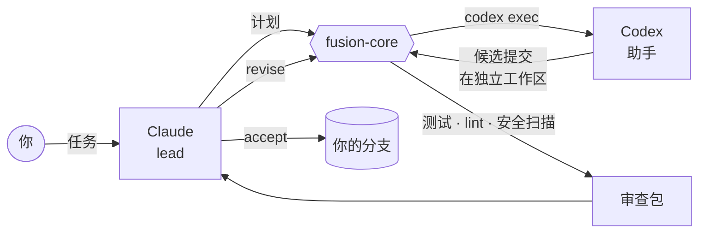

<p align="center">
  <picture>
    <source media="(prefers-color-scheme: dark)" srcset="assets/logo-dark.svg">
    
  </picture>
</p>

<p align="center">
  <strong>一个 lead,一个助手，一份审查过的结果。</strong><br>
  一个 Claude Code 插件:Claude 负责计划和审查,Codex 负责写代码,<br>
  让最强的模型把额度花在判断上，而不是打字上。
</p>

<p align="center">
  <a href="https://github.com/MuraBot/lyfusion/tree/v5.0.0"></a>
  <a href="LICENSE"></a>
  
  
</p>

<p align="center">
  <a href="README.md">English</a> · 简体中文
</p>

---

## 为什么用 lyfusion

最强的模型擅长决定*做什么*,也擅长发现哪里不对;可让它一行一行写代码就太贵了。lyfusion 把活分开:

- **Claude 当 lead。** 读代码、写计划，对照你的完整需求审查结果，决定什么时候算做完。
- **Codex 当助手。** 在独立的 git 工作区里按计划写代码、写测试、修 lint。
- **本地引擎把关。** `fusion-core` 对每个候选都跑你的测试和 lint 命令，扫描不安全的改动，再给 lead 一份精简的审查包。lead 验收之前，什么都不会进你的分支。

在我们的测试里,lead 比 Claude 单独做**少用约 30–40% 的 Claude 额度**,质量相同([详情](#测试数据))。

## 功能

- **四个阻塞式命令。** lead 用 `explore`、`delegate`、`revise`、`accept` 推进工作。每个命令都会等到助手有结果才返回,lead 每次交换只花一次请求，不用反复查看。
- **分档。** 小改动 lead 自己做;知道改哪里就直接派工;不知道就先让助手探索。
- **审查包。** 计划差异、检查结果、安全扫描、助手的提问和取舍、改动过的测试预期，以及最重要的 diff 优先，都控制在固定篇幅内。
- **检查由你定。** 每个候选都跑你的测试和 lint 命令。计划里还可以加自己的检查，比如一个证明结果正确的脚本。
- **安全合并。** 验收时重新检查，压成一个提交，快进到你的基础分支。`--minor-fix` 让助手在严格限制下做最后一处小修改。
- **出问题能接手。** 助手 10 分钟没有动静就会提醒。`takeover` 把助手的最新候选或没跑完的改动放进你的工作区;`cancel` 会留一份 diff 作证据。
- **台账。** 按任务记录 lead 的调用数、Claude 用量、助手的 token、运行时间和修改轮数。
- **Fusion 卡片。** 在 Claude 桌面应用里，模型选择器旁有一个按钮，点开是一张小卡片：开关、助手模型、推理强度、上下文上限、Fast 模式。

## 工作方式



1. **探索**(可选)。助手回答关于陌生代码的最多三个问题。
2. **派工。** lead 发出计划：目标、约束、边界情况，以及可选的 `## scope` 和 `## checks`。
3. **审查。** 引擎检查候选，返回审查包。
4. **修改或验收。** lead 提修改意见;或者验收，由引擎合并。

## 需要

- [Claude Code](https://claude.com/claude-code),桌面应用的 Code 标签页或命令行都可以。
- [Codex CLI](https://github.com/openai/codex),已安装并登录。助手模型:`gpt-6-luna`(默认,high 强度)、`gpt-6.1-sol`、`gpt-6.1-terra`。
- Python 3.10 以上(推荐 3.11 以上),只用标准库。
- Git。项目要是 git 仓库。

在 Windows 11 上开发和测试;macOS 和 Linux 还没有测过。

## 安装

在 Claude Code 的终端会话里(需要 2.1.275 或更新):

```text
/plugin install lyfusion-plugin --marketplace MuraBot/lyfusion
```

在 Claude 桌面应用里：点输入框旁的 **+**,选 **Plugins**,添加插件市场 `MuraBot/lyfusion`,再添加 **lyfusion-plugin**。

装好后开一个新会话：插件只在安装之后新开的会话里加载。

## 快速开始

1. 在项目里打开 Fusion。这条命令会先检查环境。

   ```text
   /fusion on --test "python -m pytest -q" --lint "python -m ruff check ."
   ```

2. 开一个新会话，像平时一样提需求。会话开始时 lead 会收到一份简短的使用说明，之后由它指挥助手。

3. 用 `/fusion status` 或 Fusion 卡片查看状态和设置;用 `/fusion off` 关闭。

`--lint` 可以不填。填的话，用只报错、不改文件的命令:

| 语言 | lint 命令 |
|---|---|
| Python | `python -m ruff check .` |
| GDScript | `gdlint .` |
| Java(Gradle) | `gradlew spotlessCheck checkstyleMain` |
| JavaScript / TypeScript | `npx @biomejs/biome check .` |
| C# | `dotnet format --verify-no-changes` |

## 命令

| `/fusion …` | 作用 |
|---|---|
| `on --test <命令> [--lint <命令>]` | 检查环境，在这个项目里打开 Fusion |
| `off` | 关闭 Fusion |
| `status` | 查看设置和任务 |
| `model <名称>` | 选择助手模型 |
| `effort <强度>` | 设置助手的推理强度 |
| `fast on\|off` | 开关 Fast 模式(模型支持时) |
| `compact <token 数>` | 设置助手的上下文上限 |
| `handoff clear\|write\|off` | lead 上下文变长时怎么交接 |
| `test <命令>` | 修改测试命令 |

工作流程的命令由 lead 自己运行:`explore`、`delegate`、`revise`、`accept`、`wait`、`cancel`、`takeover`、`status`、`ledger`。

## 设置

设置放在项目的 `fusion/` 文件夹里:

| 文件 | 范围 | 例子 |
|---|---|---|
| `fusion/config.json` | 项目，提交进 git | `test`、`lint`、`base_branch`、`network`(默认 `false`)、`max_change_rounds`(默认 3)、`wait_minutes`(默认 9)、`stall_minutes`(默认 10) |
| `fusion/local.json` | 个人,git 忽略 | `enabled`、助手模型和它的 `effort`、`fast`、`compact`、交接方式 |
| `fusion/decisions.md` | 项目，提交进 git | 每个任务都要遵守的设计决定 |

运行数据(`fusion/tasks/`、`fusion/runs/`、`fusion/fusion.db`)由 git 忽略。

## 测试数据

我们在两道用隐藏测试评分的私有题上，比较了 lyfusion 和 Claude 单独做:H2(33 项检查)和 L1(57 项检查)。lead 是 Claude Opus 5.5(high),助手是 `gpt-6-luna`(high)。Claude 用量按 token 类型加权：缓存读 0.1×,缓存写 1.25×,输出 5×。

| 题 | 做法 | 隐藏测试 | Claude 用量 | 用时 |
|---|---|---|---|---|
| H2 | lyfusion 5.0.0 | **100%** | **0.70×** | 15.5 分钟 |
| H2 | Claude 单独做 | 97% | 1.00× | 7 分钟 |
| L1 | lyfusion 5.0.0-rc.7 | **100%** | **0.61×** | 21 分钟 |
| L1 | Claude 单独做 | 100% | 1.00× | 11 分钟 |

代价是用时:lead 要等助手干活。这些都是两道题上各跑一次的结果，只说明大致方向，不是保证。

## 隐私和安全

- lyfusion 不调用 Claude API,不读 Claude 的配置，也不读 Codex 的登录文件。它只从 Codex 的 `config.toml` 读两项沙箱设置。
- 启动 Codex 前去掉 `CLAUDE*` 和 `ANTHROPIC*` 环境变量，默认用干净模式，助手只在自己的工作区里干活。除非项目或你自己的 Codex 设置允许，它的沙箱不能联网。
- 运行日志里常见格式的密钥会被打码，运行日志也不进 git。
- lead 的用量来自 Claude Code 的插件接口，只存在项目的 `fusion/fusion.db` 里。

## 仓库结构

| 路径 | 内容 |
|---|---|
| `plugin/` | 插件本体:`fusion-core` 引擎(`core/`)、会话钩子和 Fusion 卡片(`hooks/`)、`/fusion` 命令(`skills/`) |
| `assets/` | Logo |
| `design/`、`v5/` | 设计文档和开发记录 |
| `lint/` | 开发 lyfusion 本身用的检查清单 |
| `SKILL.md`、`addon/`、`tests/`、`viewer/` | 早期的 v4 技能，留作参考 |

## 开发

```bash
cd plugin/core && python -m pytest -q tests -n 6   # 引擎测试(用假 Codex)
claude plugin test plugin                          # Fusion 卡片测试
claude plugin validate plugin                      # 检查清单文件和钩子
```

欢迎提 issue 和 pull request,提交前请先跑测试。

## 许可证

[MIT](LICENSE)

lyfusion 是独立项目，与 Anthropic、OpenAI 没有关联，也没有得到它们的背书。Claude、Claude Code 和 Codex 是各自所有者的商标。
